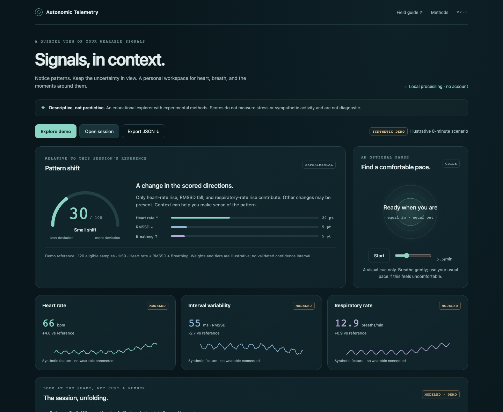

# Autonomic Telemetry

A private-by-default browser workbench for exploring how cardiac and respiratory summaries change against a fixed session reference. Open one HTML file, try a reproducible synthetic session, or inspect a normalized recording. A companion field guide explains every display and its limits.

**This is an experimental visualization, not a validated measure of stress, sympathetic activity, illness, or recovery.** The custom index and event thresholds are design choices. They have no clinical validation or confidence intervals.



## Start here

Open [Autonomic_Telemetry_Console.html](Autonomic_Telemetry_Console.html) directly in a current browser. The app is a self-contained HTML file with no runtime dependencies, external fonts, analytics, account, or server requirement. Its default session is explicitly labeled **synthetic**.

For a local web address:

```sh
python3 -m http.server 8090
```

Visit [localhost:8090](http://localhost:8090/Autonomic_Telemetry_Console.html). Read the [Field Guide](Autonomic_Telemetry_Field_Guide.html) for a tour or [Methods](docs/METHODS.md) for the exact calculations and data contract.

## What you can explore

- A deterministic 1 Hz, eight-minute synthetic session, with a preloaded two-minute reference, accelerated playback, play/pause, restart, a timeline scrubber, and presets that jump to key moments.
- A transparent 0–100 **pattern-shift index** based on heart rate, RMSSD, and respiratory rate, with channel contributions visible.
- A descriptive novelty trace and coincident change events, with explicit quality and motion gating.
- Aligned heart-rate/respiratory-rate association, heart-rate persistence, RMSSD dispersion, and a standardized heart-rate/RMSSD portrait.
- A visual breathing pacer that operates independently of the recording and its scores.
- Normalized JSON/CSV import, user markers, and JSON export that preserves source labels and missing values.
- Hume Band 2.0 daily context notes, with an explicit HRV definition selector and date.
- Retrospective context from Apple Health `export.xml`, kept separate from the session reference and model.

There is **no live device connection** in this release. Earlier Muse Web Bluetooth and OSC sketches have been retired. They would require a separately validated acquisition and signal-processing implementation before becoming supported features.

## Hume Band 2.0 first; Apple Watch also welcome

For Hume Band 2.0, choose **Add Hume reading** to note the date, resting heart rate, HRV, and respiratory rate available in your Hume app. Choose the HRV definition explicitly: **Unspecified / not confirmed**, **RMSSD**, or **SDNN**. Leave it unspecified unless the source identifies the calculation. The reading is labeled Hume Band 2.0, stays in memory, and is included in your export. Daily summaries do not become a second-by-second recording or a calibration reference. Adding another context reading or Health XML replaces the current context; this release is not a daily history tracker.

Hume's [FAQ](https://humehealth.com/en-gb/pages/faq) describes Connected Apps sharing to Apple Health/Google Fit, with incomplete metric coverage, and lists native export as “Coming Soon” (checked 2026-10-22). This release therefore assumes no Hume CSV, public API, or direct Bluetooth interface. If your shared metrics appear in Apple Health, import its XML and select the relevant source. Google Fit import is not supported.

Apple Watch users can use that same XML route, selecting their Watch source. HealthKit HRV is SDNN, which stays distinct from RMSSD. Shared views remain device neutral; the available data and its provenance determine what can be shown.

## Bring a recording

Use [examples/session-template.csv](examples/session-template.csv) for a small format example, or [examples/demo-session.json](examples/demo-session.json) for a complete synthetic session. Imports contain already-computed summaries; the console does not derive HRV from raw ECG, PPG, or RR intervals.

The JSON contract is:

```json
{
  "schema_version": 2,
  "provenance": { "kind": "user-supplied", "label": "My session" },
  "samples": [
    {
      "timestamp": "2026-10-22T10:00:00-04:00",
      "heart_rate_bpm": 62,
      "rmssd_ms": 48,
      "resp_rate_brpm": 12,
      "eeg_beta_alpha": null,
      "motion_g": 0.03,
      "quality": "good"
    }
  ],
  "markers": []
}
```

The single row illustrates the schema; a reference needs at least **60 eligible samples spanning 119 seconds**. CSV uses the same sample field names as headers. Use ISO 8601 timestamps with seconds and an explicit timezone, numeric Unix epoch **milliseconds** in JSON, or 13-digit epoch milliseconds in CSV. Rows must already be ordered at least one second apart; aggregate denser data before importing. The session limit is 20,000 samples and 20 MB. Empty numeric cells become `null`; absent information is never changed to zero. CSV defaults to **user-supplied**; JSON must explicitly declare provenance. Neither is presented as a verified measurement.

Only samples marked `quality: "good"` enter the model. `poor` and `unknown` are excluded. If `motion_g` is supplied, it must be at most 0.25 to pass the motion gate. Here `motion_g` means motion magnitude after gravity removal; raw accelerometer magnitude near 1 g is not the expected input. A missing motion value does not establish stillness.

At least two of heart rate, RMSSD, and respiratory rate must be present, and a scored sample must have the same available-channel set as its reference. The optional EEG ratio is preserved in files and displayed as a supplied value in the advanced Temporal texture panel; it has no score weight or physiological interpretation. See [Methods](docs/METHODS.md) for reference formation, supported input ranges, gaps, thresholds, and interpretation.

For Apple Health, select the unzipped `export.xml`, then choose its source name to keep Hume and Apple Watch context separate. The importer checks supported record units, chooses the latest record **by timestamp** for each supported metric within that source, and shows its date and a stale label when older than 30 days. Apple Health SDNN stays SDNN; it is not converted to RMSSD. Sparse context records cannot seed calibration or enter the index. Sleep analysis is not supported.

## Privacy and sharing

The app makes no network requests and uses no browser persistence. Imported data remains in the current page's memory; a reload clears it. Exports are ordinary files under your control and can contain sensitive health information and marker text. Keep personal recordings outside the repository and review every file before publishing. The repository examples are synthetic; `.gitignore` excludes common local data directories and Health export filenames, but cannot recognize every sensitive filename.

Loading the app from GitHub Pages still involves a request to GitHub for the static page. The console does not send imported recordings to GitHub or another service.

## Development and checks

The application itself requires no build. Automated checks use Node.js and Playwright:

```sh
npm ci
npx playwright install chromium
npm test
```

Run the tests after editing the model, importer, export, or controls. Test dependencies are for development only. [Review notes](docs/REVIEW.md) describe the main corrections made to the original prototype and the remaining scope limits.

## Publish on GitHub Pages

1. Create a repository and add this directory's contents, after reviewing them for personal data.
2. In the repository's **Settings → Pages**, choose **GitHub Actions** as the source.
3. Open **Actions**, select the included Pages deployment workflow, and run it manually against the branch you want to publish.
4. Use the deployment's page URL. The site entry point opens the console; the field guide is linked from it.

The workflow is manual so a code push does not automatically publish the app. This directory has been prepared locally; creating a GitHub repository or publishing a site is a separate action.

## Scientific context

- [Billman (2013): LF/HF does not accurately measure cardiac sympathovagal balance](https://pmc.ncbi.nlm.nih.gov/articles/PMC3576706/).
- [Laborde, Mosley & Thayer (2017): HRV research design, analysis, and reporting recommendations](https://pmc.ncbi.nlm.nih.gov/articles/PMC5316555/).
- [Apple HealthKit: heart rate variability SDNN](https://developer.apple.com/documentation/healthkit/hkquantitytypeidentifier/heartratevariabilitysdnn).

These sources inform physiology and measurement cautions. They do **not** validate this dashboard's index, tiers, novelty calculation, or event detector. Only HR increases, RMSSD decreases, and respiratory-rate increases contribute to the index. A low score means little shift in those scored directions; large changes in the opposite directions can also score zero. The score does not establish closeness to the reference, a cause, or a health condition.

## Reuse

No license has been selected yet. Choose a license before inviting others to reuse or redistribute the code.
