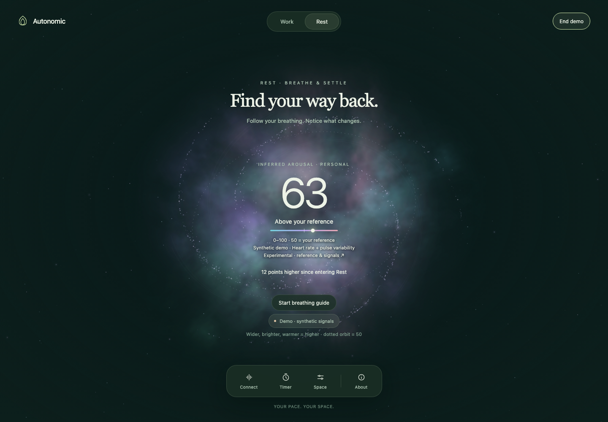
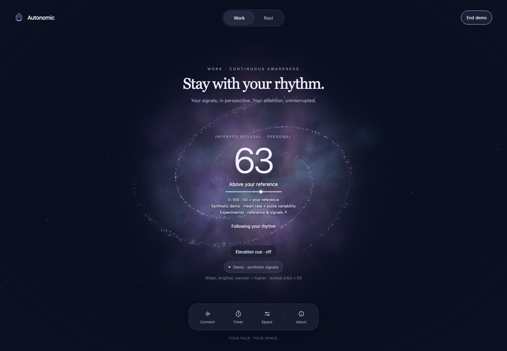

# Autonomic Telemetry

**[Open the experience](https://patrickiben.github.io/autonomic-telemetry/)** · [Field guide](https://patrickiben.github.io/autonomic-telemetry/Autonomic_Telemetry_Field_Guide.html)

An immersive canvas with a personal, experimental **inferred arousal estimate**. Hume's reported heart rate and eligible Muse pulse-interval variability are compared with an initial personal reference. Accepted Muse pulse rate can supply HR when Hume is absent, with an explicit source change. The estimate is 0–100, with 50 representing that reference; it is an inference from cardiac patterns, not a direct measure of sympathetic activity or a mental-state diagnosis.

Work supports continuous observation and an optional sustained-elevation cue. Rest adds paced breathing and a personal settling trend. Both use the same estimate; their different palettes and controls do not change the scoring rules. An optional timer stays secondary to the experience.

The estimate controls the galaxy or nebula's extent, brightness, and warmth against a fixed reference orbit at 50. Work uses a slow spiral; Rest uses a diffuse cloud with a separate breathing ring.

The **[Advanced Signal Lab](Autonomic_Telemetry_Signal_Lab.html)** preserves the separate recording explorer, pattern-shift model, reference and novelty diagnostics, import/export, and research lenses. Its recording score is distinct from the canvas's live inferred-arousal estimate.



Screenshots use the labeled synthetic demo, not recorded personal signals.

Use an explicitly labeled demonstration to explore the visuals, or connect a Muse S and Hume Band 2.0 through the local Mac bridge. Muse supplies raw EEG, optical PPG, and motion; Hume supplies device-reported heart rate. Source and freshness labels distinguish live, waiting, paused, and demonstration input.

The estimate includes source, reference progress, and feature availability. An explicitly labeled HR-only track remains useful when pulse variability is unavailable; it has its own reference and trend rather than silently changing the two-feature weights. EEG remains context, with no weight in the estimate. Neither the estimate nor the visuals grade attention, meditation, or health. Device support is experimental. Bounded physical transport tests passed with one Athena Muse S and one Hume Band V2; those tests establish transport behavior, not the accuracy of this new inference. See the [device guide](docs/DEVICES.md).

Apple Watch information is retained in the [device guide](docs/DEVICES.md#apple-watch-keep-it-as-separate-health-context); the current canvas does not supply a live Watch feed or Health XML import.



## Live on an iPhone

A nearby Mac handles Bluetooth. Safari on your iPhone receives the visuals over the same trusted Wi-Fi:

1. Download or clone this repository onto the Mac and install Python 3.10 or newer.
2. Open [Start-iPhone-Bridge.command](scripts/Start-iPhone-Bridge.command) in Terminal. Its first run installs the pinned bridge dependencies.
3. Keep the Mac awake. In its Connect sheet, scan the phone QR code with your iPhone camera and open the link in Safari. The private address printed in Terminal is a fallback.
4. Choose **Connect**, scan, select the actual wearables, and connect. If a vendor app holds a device, disconnect it there when you are ready to switch.

[The bridge guide](docs/BRIDGE.md) covers setup, permissions, source limits, and troubleshooting. The local connection uses **unencrypted HTTP**; use a trusted private Wi-Fi network, keep the private address private, and do not expose the port to the internet. The public GitHub Pages site cannot run the Bluetooth bridge.

## Open locally

[Autonomic_Telemetry_Console.html](Autonomic_Telemetry_Console.html) is a self-contained page with inline assets and system fonts. Open it directly, or serve the directory:

```sh
python3 -m http.server 8090
```

Then open [localhost:8090](http://localhost:8090/Autonomic_Telemetry_Console.html). Serving static files alone does not start the Bluetooth bridge; use the launcher for the iPhone connection.

## How it works

- [Field Guide](Autonomic_Telemetry_Field_Guide.html): a short tour of the experience.
- [Devices](docs/DEVICES.md): Muse and Hume input boundaries.
- [Visual mappings](docs/BIOREACTIVITY.md): what drives the canvas and what the labels mean.
- [Methods](docs/METHODS.md): the live inferred-arousal formula, personal reference, uncertainty, and transport.
- [Advanced Signal Lab methods](docs/SIGNAL_LAB_METHODS.md): recording schema, fixed reference, index, novelty, and context.
- [Research engine methods](docs/RESEARCH_ENGINE.md): the additional audited mathematical lenses and their input requirements.
- [Bridge](docs/BRIDGE.md): the runnable Mac-to-iPhone route.
- [Review](docs/REVIEW.md) and [validation](docs/VALIDATION.md): release scope and verification.

Raw signals are handled in memory. The bridge does not need an account, a cloud relay, Health uploads, or a recording database. Demonstration input is labeled and is not a substitute for missing live data.

## Development

The page needs no build. Browser checks use Node.js and Playwright:

```sh
npm ci
npx playwright install chromium
npm test
```

The local bridge uses Python with pinned [Bleak](https://pypi.org/project/bleak/3.0.2/) and [qrcode](https://pypi.org/project/qrcode/8.2/) dependencies:

```sh
python3 -m venv .venv-bridge
.venv-bridge/bin/python -m pip install -r bridge/requirements.txt
.venv-bridge/bin/python -m bridge.server --simulate --open
```

`--simulate` tests the local transport with explicitly synthetic input. It does not read Bluetooth or establish hardware compatibility. See [bridge development notes](bridge/README.md).

## GitHub Pages

The public experience is hosted at [patrickiben.github.io/autonomic-telemetry](https://patrickiben.github.io/autonomic-telemetry/). To publish reviewed changes after pushing, use **Actions → Deploy GitHub Pages (manual) → Run workflow**. For a fork, enable **Settings → Pages → GitHub Actions** first. The Python bridge runs on your Mac, not on Pages.

## Reuse

Original project code is available under the [MIT License](LICENSE). Protocol adapters preserve applicable upstream notices.

## Code license and third-party material

Original project code is licensed under [MIT](LICENSE), copyright 2026 Patrick Iben.
Third-party code, fonts, data, model assets and outputs retain their respective licenses and terms;
they are not relicensed by this file.
